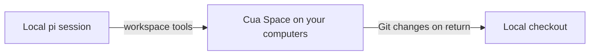

<p align="center">
  <a href="https://cua.ai/">
    <picture>
      <source media="(prefers-color-scheme: dark)" srcset="assets/cua-lockup-white.png">
      
    </picture>
  </a>
</p>

<h1 align="center">pi-cua</h1>
<p align="center">Your pi coding sessions. Your computers. Cua Spaces.</p>
<p align="center">
  <a href="#get-started">Get started</a> ·
  <a href="#choose-a-space">Choose a Space</a> ·
  <a href="https://cua.ai/docs/spaces/concepts/how-spaces-works">Cua Spaces docs</a>
</p>

---

## Local pi. Work on a Space.

Cua Spaces gives people and agents shared desktops on computers you own or rent: your computer, another computer you connect, or a VM in your own cloud account. A Space can be a container, a virtual machine, or a computer's own desktop—not a Cua-hosted computer. See [how Spaces works](https://cua.ai/docs/spaces/concepts/how-spaces-works).

pi-cua connects pi to Linux and macOS Spaces. Keep pi, your extensions, skills, settings and model credentials local; run workspace tools on the selected Space and bring Git changes back when you return. Cua Spaces tools are also discoverable through `tool_search`.



## Get started

```sh
pi install git:github.com/injaneity/pi-cua
```

Install the `cua` CLI, or use the [Cua Spaces app](https://cua.ai/). Local Spaces and direct connections do not require a Cua account. Sign in to reach your computers through the Cua relay:

```sh
curl -fsSL https://cua.ai/install.sh | sh -s -- --cli-only --yes   # on this computer
cua auth login

# on each computer you want to connect (or use the Cua Spaces app)
curl -fsSL https://cua.ai/install.sh | sh -s -- --only host --yes
```

Follow [Add a computer](https://cua.ai/docs/spaces/guides/add-a-computer) to connect another computer or let it host Spaces.

Then run `/space` in pi to choose from your available Spaces. `/space create` creates and enters a Space on this computer; creation requires a supported local runtime.

A Space needs `node` and `git`, which the canonical Cua images ship. pi-cua checks for them on entry.

## Choose a Space

`/space` and the agent's `space` tool take the same argument:

| argument | does |
|---|---|
| _(none)_ | lists Spaces; `/space` opens a picker |
| `<name>` | enters that Space |
| `local` | brings the work back into your checkout and runs locally again |
| `create [name]` | creates a Space on this machine and enters it |
| `delete <name>` | deletes a Space |
| `auth` | checks GitHub authentication on the current Space |

Creating and deleting always ask you to confirm, whoever asks. Resume never substitutes a different machine: if the saved Space is gone or reports a different machine identity, pi stops and asks you to choose.

## Your accounts stay yours

Credentials stay on their own machine. Model and MCP sign-ins remain local; command-line tools on a Space use that Space's accounts. No OAuth tokens, SSH keys or credential files are copied or forwarded.

After entering a Space, `/space auth` checks the GitHub CLI without displaying credentials. It reports whether `gh` is missing or authentication is unavailable and suggests the next step. Run interactive sign-in in a terminal on the Space (not pi's non-interactive `!` shell); browser/device-code flows can be approved from your own browser. GitHub HTTPS Git access may additionally need `gh auth setup-git`; SSH remotes need their own SSH authentication. There is no cross-environment GitHub action sharing yet.

Pasted `pi-clipboard-*` images in pi's local temporary directory remain readable from your machine while workspace reads run remotely. This exception is read-only and does not route arbitrary local paths.

The picker shows online Spaces first, then those still being checked, then offline Spaces. Availability updates preserve your filter and selected Space.

## Cua Spaces tools

The tool catalogue exposed by the installed Cua Spaces SDK—including Space management, agents, sharing, Teleport and more—is registered as `cua_<tool>` at startup. Tool definitions stay out of the prompt until `tool_search` loads them. Availability depends on your SDK version and connected computers. Any tool the SDK marks destructive asks you to confirm first, whether you or the agent called it.

## From your checkout and back

```
enter(space)
  1. resolve   online, node and git present, same machine as before
  2. copy      your Git workspace, only the objects the Space is missing
  3. route     read · write · edit · bash · find · grep · ! → the Space
```

- **workspace.** For a Git repository with a network `origin`, pi-cua copies your working tree, including uncommitted and untracked files, into `~/.cua-pi/work/<execution>`. It sends only the Git objects the Space is missing and verifies the full tree before use. If the Space cannot reach `origin`, it starts from a commit snapshot instead. Moving between Spaces transfers objects through your machine; `/space local` applies one tree diff to your checkout, merging non-conflicting local edits. Directories outside Git get a separate empty execution directory and are not synchronized.
- **tools.** pi's own tools run unchanged; only their file and shell operations go to the Space through spacesd. Output streams back, and cancelling kills the command on the Space. Every other tool, such as web search or papercuts, runs on your machine. If another extension replaces one of the six tools, it is blocked while you are on a Space instead of quietly acting on local files.

`/new` and `/fork` inherit the Space with their own copy of the workspace.

## Supported today

- Cua Spaces supports macOS, Linux and Windows. pi-cua currently routes workspace tools to Linux and macOS Spaces; Windows execution and workspace transfer are not yet implemented in this integration.
- Submodules, Git content filters and working-tree encodings are not transferred. Transfers are limited to 200 MiB.
- Sessions on one Space share its user, files and logins. Use a dedicated Space when that matters.
- Workspaces stay on the Space until you return with `/space local`.

## Development

```sh
npm test
```

The tests run the real workspace transfer and pi's own tools against local fake Spaces with their own home directories.

---

Cua marks are provided by [Cua's brand assets](https://cua.ai/branding). pi-cua is an integration for pi; Cua Spaces provides the connected desktops.
